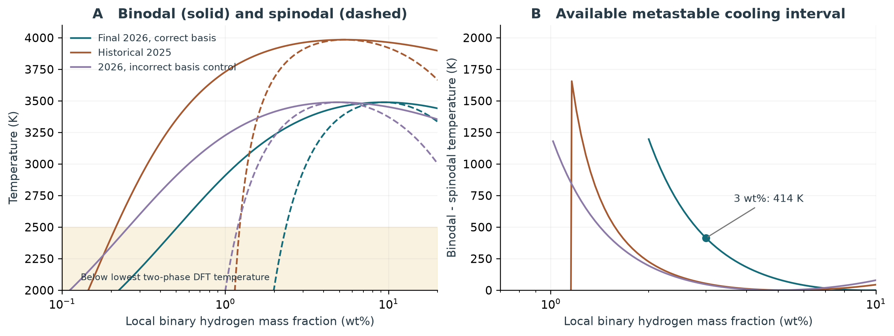

# Delayed hydrogen separation: a focused study

**Question:** how much hydrogen separation can be delayed between the equilibrium binodal and the spinodal during cooling of a closed H2-MgSiO3 parcel?

**Result:** with the final 2026 fit, a parcel containing **3 wt% local hydrogen at 2 GPa** enters the miscibility gap at **3355.9 K** and loses local stability at **2942.2 K**. At the spinodal, equilibrium would already place **65.5% of the hydrogen** in a separate H-rich phase. The **413.7 K** interval is much larger than the **53.2 K** obtained with our historical 2025 parameterization.

This is an inventory bound under an imposed **no-nucleation-until-spinodal** limit, not a calculated nucleation time, atmospheric abundance or planetary mass loss. All hydrogen is conserved. The delayed parcel still contains its hydrogen mixed with silicate. Existing interfaces could largely eliminate the delay.

Read the [nine-page research draft](output/pdf/delayed_hydrogen_exsolution.pdf), [protocol](PROTOCOL.md), and [computed summary](outputs/key_results.json). The report covers methods, results, source-data mismatches, identifiability, and the next decisive experiment. It is a paper candidate, **not yet submission-ready**.



## What was improved in Atmodeller

- `SubregularSolution.hydrogen_silicate_gilmore26()` adds the final Gilmore & Stixrude (2026) coefficients.
- The published composition is `z=n(H2)/[n(H2)+n(MgO)+n(SiO2)]`. Atmodeller uses native `(MgSiO3,H2)` formula units, with H2 fraction `y`. Thus `z=y/(2-y)` and **`G=(2*n_sil+n_H2)*g_fit(z)`**. A positive static `component_0_multiplicity` applies this conversion to energy, derivatives, activities, binodals and phase inventories consistently. Simply converting the endpoints is insufficient.
- `spinodal_temperature(P,y)` analytically locates curvature zeros, while `equilibrium_gibbs_energy(T,P,y)` returns the common-tangent convex envelope.
- Homogeneous activities now retain finite trace-component log fractions instead of losing them when exponentiation rounds the dominant fraction to one.
- The original 2025 constructor and its archived results are preserved.

The existing public selector `phase_equilibrium="spinodal"` continues to mean **common-tangent equilibrium**, including the metastable portion of the binodal. The study's delayed history is an explicit limiting assumption in `run_study.py`; it does not change the solver's equilibrium semantics. See the [API guide](../../docs/spinodal.rst).

## Main results

| Case: 3 wt% local H | Binodal (K) | Spinodal (K) | Interval (K) | Equilibrium H in rich phase at spinodal |
|---|---:|---:|---:|---:|
| Final 2026, 2 GPa | 3355.9 | 2942.2 | 413.7 | 65.5% |
| Final 2026, 5 GPa | 3050.8 | 2674.7 | 376.1 | 65.5% |
| Final 2026, 10 GPa | 2542.4 | 2228.9* | 313.4* | 65.5%* |
| Historical 2025, 2 GPa | 3961.6 | 3908.4 | 53.2 | 39.0% |
| Deliberately incorrect 2026 basis, 2 GPa | 3467.7 | 3421.8 | 45.9 | 36.1% |

\* Below the lowest tabulated two-phase DFT temperature (2500 K): model extrapolation. Neither 2000 K nor 2500 K is a computed melting boundary.

At 3000 K and 2 GPa, the final 3 wt% case is metastable. Equilibrium puts **61.4% of the H** in the rich phase; the delayed limit has not separated. In a 1 kg parcel this is **18.4 g of H assigned differently**, with the same 30 g total H. The Gibbs-energy decrease is 2.98 kJ per native mole, not a heat-release prediction.

At 1 wt% there is no positive-temperature spinodal in this fit's positive-excess-factor regime, although equilibrium separation occurs. The formal lower spinodal threshold is 1.404 wt% local H, versus 1.006 wt% in the old fit and 0.707 wt% under a naive basis import. These are neither universal thresholds nor whole-planet hydrogen budgets.

### Why the inventory result is insensitive to pressure

Writing `g_fit/(RT)=s(z)+r*h(z)`, the spinodal fixes `r=-1/[z*(1-z)*h''(z)]`. Therefore, at a given bulk composition, the common-tangent endpoints evaluated at the spinodal depend on the shape of `h`, not on pressure, C or D. Both boundary temperatures scale with `(1+P/D)`. The near-invariance is **a structural consequence of this separable model**, not evidence of strong empirical precision.

For 3 wt% at 2 GPa, deterministic +/-10% changes in A, B, C and |D| give intervals of **329-504 K** and H inventory bounds of **64.4-66.3%**. These are stress scenarios, not confidence intervals or calibrated parameter uncertainties.

### What the existing data fail to constrain

The final fit agrees with **10/10 single-phase classifications**, but reproduces both endpoints within the tabulated +/-0.05 tolerance for only **1/4 two-phase pairs**. Allowing for each pair's quoted pressure uncertainty does not change that count. Reconstructing excess enthalpy, entropy and volume from the authors' homogeneous simulations also reveals mismatches, especially in volume. Table 2's pure and mixed states have small pressure offsets, and propagated errors share endmember covariance; a formal joint fit needs to account for these.

These are reproduction checks of the same data used to develop the fit, not independent validation. They do not prove the simulations are wrong. No data were dropped and no coefficients were silently refitted.

`identifiability.py` constructs a nonnegative C2 bump inside the binodal:

```
u = (z-a)/(b-a)
delta_g = lambda * B(T,P) * 64*u**3*(1-u)**3    for a < z < b
delta_g = 0                                  otherwise
```

Here `(a,b)` is the baseline binodal and `B` its midpoint energy above the common tangent. For nonnegative lambda, the equilibrium convex envelope is unchanged exactly. The bump and its first two composition derivatives vanish at the endpoints, and it is zero at all the homogeneous Table 2 states. Nevertheless, lambda=8 shifts the 3 wt% spinodal by **35.9 K**; the 5 wt% spinodal shifts by **-13.5 K**. These arbitrary amplitudes are a **counterexample to uniqueness**, not a recommended material model. Coexistence data alone do not identify metastable curvature.

## Publication assessment

The worthwhile direction is **composition-consistent bounds on delayed exsolution and the inability of existing equilibrium data to identify spinodal onset**. Merely plotting a spinodal would repeat published work. The numerical work here supplies a reproducible pilot and a clear testable claim, not a completed atmospheric prediction.

The next decisive work is to reconcile the source fit and obtain homogeneous free-energy derivatives inside the metastable gap, followed by interfacial-energy/mobility and heterogeneous-nucleation constraints. Only after that should an evolution/transport calculation claim an atmospheric effect. A concrete target is 2 GPa, 3000-3400 K and published-basis `z≈0.35-0.55`. No authors were contacted and no new ab initio simulations were performed.

## Reproduce

From the repository root with the checked-in environment:

```sh
uv sync --locked --all-extras --dev
uv run python research/spinodal_onset/verify_artifacts.py
```

To recompute and deliberately establish a new artifact snapshot:

```sh
uv run python research/spinodal_onset/run_study.py
uv run python research/spinodal_onset/identifiability.py
uv run python research/spinodal_onset/make_figures.py
uv run --with reportlab python research/spinodal_onset/build_report.py
uv run python research/spinodal_onset/make_explorer.py
uv run python research/spinodal_onset/verify_artifacts.py --write-manifest
```

`verify_artifacts.py` checks the delivered file hashes and analysis invariants. Regeneration changes timestamps and can change binary files; use `--write-manifest` only to deliberately establish a new artifact snapshot after successful validation. The recorded environment used Python 3.13 and the package versions in `outputs/provenance.json`; source hashes make the analysis independent of an uncommitted source label.

| Files | Purpose |
|---|---|
| `sources/EDTable*.xlsx`, `sources/manifest.json` | Original CC-BY-4.0 data, attribution and hashes |
| `outputs/onsets.csv`, `critical_points.csv` | 20,664 onset rows across three models and critical properties |
| `outputs/cooling_paths.csv`, `stopping_temperatures.csv` | 10,827 cooling states and sensitivity to path endpoints |
| `outputs/source_data_audit.csv`, `homogeneous_data_audit.csv` | Every tabulated coexistence/single-phase state and homogeneous properties |
| `outputs/sensitivity.csv` | 375 parameter stress cases |
| `outputs/identifiability*.csv`, `identifiability_checks.json` | Constructed equilibrium-preserving perturbation and checks |
| `outputs/native_solver_*`, `root_crosschecks.json` | 27 native API solves and independent root tests |
| `figures/` | Five standalone PNG/SVG figures |
| `explorer.html` | Self-contained interactive reader of nine computed cooling paths |
| `validation/`, `artifact_manifest.json` | Full test log, focused checks and artifact verification |

The full suite passed **288 tests**; three performance tests were deselected. Maximum elemental and lever-rule errors are about 2.2e-16. Spinodal inventory invariance is verified to <1e-9 away from criticality. A sampled point only 0.0213 wt% from the critical composition has a 7.3e-6 absolute spread in H fraction due to the ill-conditioned lever rule as endpoints merge; the measured discrepancy is retained in `key_results.json`. This has no material effect on the 3 wt% result.

## Primary references (checked 29 October 2026)

- [Gilmore & Stixrude 2026, Nature](https://doi.org/10.1038/s41586-025-09970-4), equations 1 and 8-11; [source data](https://doi.org/10.5281/zenodo.17716049).
- [Rogers, Young & Schlichting 2025](https://doi.org/10.1093/mnras/staf1940), historical control.
- [Rogers & Schlichting 2026 v2](https://arxiv.org/abs/2606.30644v2), revised October 14; [Tejada Arevalo et al. 2026 v2](https://arxiv.org/abs/2601.00059v2), revised March 18.
- [Young et al. 2025, PSJ 6, 251](https://doi.org/10.3847/PSJ/ae1012), including binary spinodals; [Young & Werlen 2026 v2](https://arxiv.org/abs/2604.28135v2), revised June 28.
- [Hakim et al. 2026](https://doi.org/10.1093/mnras/stag133), downstream atmospheric chemistry; [Bower et al. 2025](https://doi.org/10.3847/1538-4357/ae1479), Atmodeller.

The prior [atmospheric-feed experiment](../spinodal_study/README.md) and [hydrogen-storage archive](../README.rst) retain their original code/data provenance. They do not use the new 2026 constructor.
